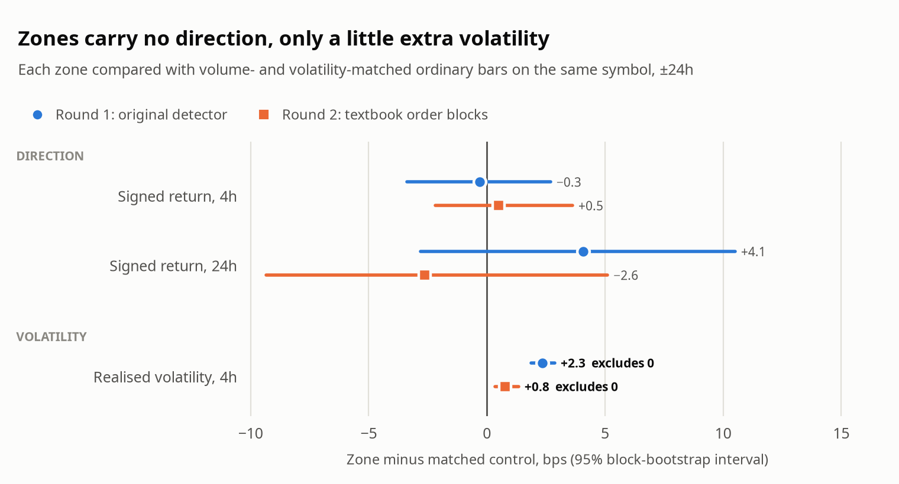

# do-order-blocks-work

**Do order blocks predict where crypto prices go next?**

Order blocks are a popular trading idea: certain candles supposedly mark zones where price
will react, in a predictable direction. This project tests that on two years of 15-minute
Binance data for 76 altcoins (Sep 2024 - Sep 2026).

**Answer: not here.** The direction an order block points to is no better than the direction
of a random candle picked to look similar, and no way of trading it that was tested makes money
after costs. The one real effect is that order blocks mark slightly *more volatile* moments.
It is small, it says nothing about direction, and nothing here turns it into a profitable
trade.

<picture>
  <source media="(prefers-color-scheme: dark)" srcset="results/zone_vs_matched_control-dark.png">
  
</picture>

## The results in one table

Two definitions of an order block were tested, each through the same pipeline:

- **Round 1** uses the detector from a live alerting bot: high-volume, long-wick candles near a
  swing high or low, pointing the way the candle closed.
- **Round 2** uses the textbook ("smart money concepts") definition: the last opposite-coloured
  candle before a break of structure, pointing the way of the break.

| | Round 1 | Round 2 |
|---|---|---|
| Zones found | 152,266 | 218,217 |
| Direction vs random look-alike candle, 4h ahead | −0.31 bps [−3.38, +2.69] | +0.50 bps [−2.17, +3.63] |
| Extra volatility vs random look-alike candle, 4h ahead | +2.35 bps [+1.88, +2.87] | +0.77 bps [+0.34, +1.34] |
| Best average trade after costs | −8.86 bps | −7.6 bps |
| Months profitable after costs (walk-forward) | 0 of 21 | 3 of 21 |
| Deflated Sharpe ratio (corrected for configurations tried) | 0.00 | 0.00 |

bps = basis points (0.01%). Brackets are 95% intervals; an interval that contains zero means
no detectable difference. Costs are modelled on MEXC futures taker fees.

## How it was tested

- **Against look-alike candles, not against zero.** Every order block is compared with random
  candles from the same coin, within 24 hours, with similar volume and volatility. This
  separates "order blocks predict direction" from "order blocks happen at busy moments".
- **The test can find an edge when there is one.** A planted +25 bps edge is detected, and
  random trade directions are flagged as significant 4 times in 60 at a nominal 5%.
- **No peeking at the future.** A leakage audit checks that no feature or label uses data from
  after the moment it describes.
- **Every configuration tried is counted.** A trial ledger records every variant evaluated, and
  the headline statistics are corrected for that number.

## What this does and does not show

- **Shown, for this data:** for these 76 coins, 15-minute candles, these two years and these
  cost assumptions, neither definition's direction beats a look-alike candle, and no tested
  configuration is profitable after costs.
- **Not shown:** that order blocks never work. Other timeframes, higher-timeframe structure,
  combining with other signals, other markets and limit-order execution were not tested.
- **Only observed, not explained:** the volatility effect, and the improvement from waiting for
  price to come back to the zone before entering.
- **Exploratory:** only one further test (Family A, under "Read more") was pre-registered; rounds 1 and 2
  were not ([`docs/deviations.md`](docs/deviations.md)).

Known limitations: costs are modelled rather than measured, the coin list was chosen by recent
volume, some thresholds in round 1 were set by hand, and when one 15-minute bar hits both the
target and the stop, the lower level is assumed to be hit first: the stop for a long, but the
target for a short, which flatters short trades. Each is discussed, with the direction of its bias,
in [`docs/methodology.md`](docs/methodology.md) and [`docs/PROVENANCE.md`](docs/PROVENANCE.md).

## Try it (about 5 minutes, no download)

Requires Python 3.11-3.14.

```bash
python -m venv .venv && source .venv/bin/activate      # Windows: .venv\Scripts\activate
pip install -e ".[dev]"
pytest -m "not integration"     # unit tests, under a minute
hawk-research smoke              # the full pipeline on a synthetic market, about 2 minutes
```

The smoke run builds a fake market with planted order-block shapes and runs every stage end to
end. Its numbers mean nothing about real markets; it shows that the pipeline runs and gives the
same answer on every machine. (The command is called `hawk-research` after the alerting bot the
study started from.)

To reproduce the published numbers from real Binance data (about 200 MB to download, then
about 8 minutes on a 12-core laptop):

```bash
make download reproduce
```

Full instructions, the pipeline stages, configuration and the repository layout are in
[`docs/REPRODUCING.md`](docs/REPRODUCING.md).

## Read more

- [`docs/OVERVIEW.md`](docs/OVERVIEW.md): a two-page summary of everything tested.
- [`docs/methodology.md`](docs/methodology.md): how each test works.
- [`docs/archive/round1_findings.md`](docs/archive/round1_findings.md) and
  [`docs/archive/round2_smc_findings.md`](docs/archive/round2_smc_findings.md): full results.
- [`docs/archive/s1_s5_results.md`](docs/archive/s1_s5_results.md): Family A, two refined
  systems tested against a pre-registration; both failed.
- [`experiments/`](experiments/README.md): three side studies (zone straddles, a daily fade,
  market-neutral pairs); none profitable.
- [`docs/deviations.md`](docs/deviations.md): every place the work departs from its own protocol.
- [`docs/PROVENANCE.md`](docs/PROVENANCE.md): how the project came about, what cannot be
  verified, and the use of AI in building it.

## License

MIT; see [`LICENSE`](LICENSE).
